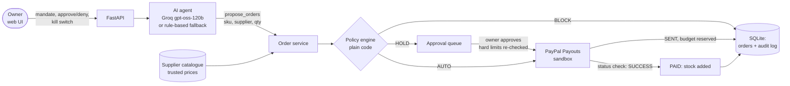

# Agent Allowance

**Give your AI restocking agent a spending allowance it cannot break.**
The agent decides what to reorder; a plain-code policy engine decides
whether it may pay; PayPal pays the supplier.

**Live demo:** https://agent-allowance-opre.onrender.com/
(free hosting: the first visit after a quiet spell can take about a
minute to wake up. Click **Reset demo** first, the demo state is shared.)

Built for the PayPal AI Hackathon, November 2026.

---

## The problem

AI agents can now browse, compare and pay. Small business owners would
happily hand off the boring, recurring job of restocking (milk, cups,
coffee beans) but nobody wants to give an AI an open wallet. Today the
choice is "do it yourself" or "trust the bot completely".

## Who it is for

Small business owners (a cafe in this demo) who want to **delegate
restocking to an AI agent** while keeping firm control of the money:
how much it may spend, with whom, on what, and when it must ask first.

## How it works

1. **The owner sets a mandate:** monthly budget, max per order, an
   "ask me above $X" threshold, approved suppliers, allowed categories
   and a maximum price rise over the usual price.
2. **The AI agent** watches stock, compares supplier quotes and proposes
   orders sized for about 7 days of sales. The most urgent items (fewest
   days of stock left) are funded first.
3. **A plain-code policy engine** (not the AI) checks every order and
   returns one of:
   - **AUTO**: inside every limit, paid straight away.
   - **HOLD**: a soft limit tripped (over the "ask me" amount, or a
     price spike). It waits in the owner's approval queue.
   - **BLOCK**: a hard limit tripped (unapproved supplier, category not
     allowed, over the per-order limit or the budget, kill switch on).
     Nothing is paid and the reason is shown.
4. **PayPal Payouts** pays the supplier for every AUTO or approved
   order. The order shows **Paying...** until PayPal confirms the payout,
   then **Paid** and the stock arrives. The money is reserved against
   the budget the moment it is sent, so in-flight payments still count
   toward every limit; a failed payout releases it.
5. **Audit log and kill switch:** every proposal, decision, approval and
   payment is logged. One switch blocks all new spending instantly, even
   for orders that were already waiting for approval.

## Why PayPal is central

Every approved order is a **real PayPal sandbox payout** from the shop
to the supplier's PayPal account (Payouts API, `POST
/v1/payments/payouts`), and the app only marks an order Paid, adds the
stock and counts the spend after PayPal reports the payout as
`SUCCESS`. Without PayPal nothing gets paid and nothing gets restocked:
the agent's whole job ends in a PayPal payment. Payment references
(`PAYPAL-<payout_batch_id>`) appear on every order and in the audit log.

## What the AI does, and what it cannot do

| The AI agent (LLM) can | The AI agent cannot |
|---|---|
| Read low-stock items and every supplier quote | Touch payments or PayPal at all |
| Choose a supplier and quantity per item | Set or change a price (prices come from the supplier catalogue) |
| Re-route a blocked item to an approved supplier | Change a category, a limit or the mandate |
| Write a plain-language report of what happened | Skip the policy engine or approve its own held orders |

The model's only way to spend is the `propose_orders` tool. Each order
in it goes through the same policy engine as everything else, and the
batch is re-sorted by urgency in code. If the AI call fails or the
usage cap is reached, a rule-based planner takes over so the demo never
stops.

## 2-minute demo walkthrough (for judges)

1. Open the [live demo](https://agent-allowance-opre.onrender.com/) and
   click **Reset demo**.
2. Click **Run agent**. In a few seconds the **Agent's report** panel
   shows the AI's summary (labelled with the model):
   - Oat milk ($96.00) and cups ($22.40): **AUTO**, shown as
     **Paying...** and then **Paid** about 20 seconds later (real PayPal
     sandbox payouts; the page refreshes itself).
   - Whole milk ($105.00, over the $100 "ask me" line) and coffee beans
     (50% price spike): **HOLD**, in **Needs your approval**, sorted by
     how soon they run out.
   - Cleaning spray: **BLOCK**, category not allowed.
   - Tea bags: **BLOCK** at the cheaper unapproved supplier, then the AI
     re-routes them to an approved supplier and they are paid.
3. In **Inventory**, low items carry the reason they are still low
   ("Awaiting your approval", "Blocked: ...", "Paying...").
4. **Approve and pay** the whole milk: it goes Paying... then Paid.
   **Deny** the coffee beans.
5. Flip the **kill switch** off and click **Fast-forward one day** a few
   times, then **Run agent**: every new order is blocked.
6. Turn the switch back on, then try **Autopilot** + **Play time** to
   watch stock drain and the agent reorder by itself.
7. Scroll to the **Audit log** for the full trail, including the PayPal
   payout references.

## Architecture



| Layer | Tech |
|---|---|
| Web app and API | Python 3.12, FastAPI, Uvicorn, one-file vanilla JS UI |
| Storage | SQLite |
| AI | Groq (OpenAI-compatible API), model `openai/gpt-oss-120b`, tool calling |
| Payments | PayPal Payouts API (sandbox), OAuth client credentials |
| Hosting | Render (free web service, `render.yaml` Blueprint) |
| Tests | pytest (78 tests, PayPal and the LLM are mocked) |

Code map:

- `app/policy.py`: the rules. Every BLOCK rule is checked before any
  HOLD rule.
- `app/service.py`: order flow, approvals, payment settlement, state.
- `app/agent.py`: LLM tools and loop, rule-based planner, usage cap.
- `app/payments.py`: `PayPalPayments` (Payouts) and `FakePayments`.
- `app/autopilot.py`: background loop (simulated days, autopilot,
  payout status checks).
- `app/static/index.html`: the dashboard.

## Run it locally

Needs Python 3.12. Without any keys it runs with fake payments and the
rule-based agent, so it works out of the box.

**Windows (PowerShell)**

```powershell
python -m venv .venv
Set-ExecutionPolicy -Scope Process -ExecutionPolicy Bypass
.venv\Scripts\activate
pip install -r requirements.txt
copy .env.example .env
pytest
uvicorn app.main:app --reload
```

**macOS / Linux**

```bash
python3 -m venv .venv
source .venv/bin/activate
pip install -r requirements.txt
cp .env.example .env
pytest
uvicorn app.main:app --reload
```

Open http://127.0.0.1:8000/ (API docs at `/docs`).

### Environment variables

Set these in `.env` locally or in your host's settings. Never commit
real values.

| Name | Purpose |
|---|---|
| `PAYMENTS_BACKEND` | `fake` (default) or `paypal` |
| `PAYPAL_CLIENT_ID`, `PAYPAL_CLIENT_SECRET` | PayPal sandbox REST app credentials |
| `PAYPAL_SUPPLIER_EMAILS` | Sandbox account email per supplier: `sup_a=<email>,sup_b=<email>` |
| `PAYPAL_BASE_URL`, `PAYPAL_CURRENCY` | Optional; default sandbox URL and `USD` |
| `LLM_API_KEY` | Groq (or any OpenAI-compatible) key; empty = rule-based agent |
| `LLM_BASE_URL` | e.g. `https://api.groq.com/openai/v1` |
| `LLM_MODEL` | e.g. `openai/gpt-oss-120b` |
| `LLM_REASONING_EFFORT` | Optional, e.g. `low` (fewer tokens) |
| `LLM_MAX_PER_HOUR`, `LLM_MIN_GAP_S` | AI usage cap; defaults 15 runs/hour and 60 s apart |
| `DB_PATH` | SQLite file path (default `app/agent_allowance.db`) |

### Using real PayPal sandbox payouts

1. At developer.paypal.com create a sandbox REST app and copy its
   client ID and secret.
2. Under Sandbox Accounts create two **business** accounts for the
   suppliers and put their emails in `PAYPAL_SUPPLIER_EMAILS`.
3. Set `PAYMENTS_BACKEND=paypal`, restart, **Reset demo**, **Run
   agent**. Log in to sandbox.paypal.com as a supplier to see the
   money arrive.

### Tests

```bash
pytest
```

Tests always use fake payments and a scripted fake LLM, so they need no
keys and send no real payouts.

## Known limitations

- Sandbox only; no real money moves.
- Deliveries arrive the moment a payout is confirmed (supplier lead
  times are not simulated) and the monthly budget does not reset.
- The hosted demo is one shared shop: anyone with the link sees the
  same state, and it resets when the free server restarts.
- On Groq's free tier one AI run fits per minute; faster runs use the
  rule-based planner and are labelled as such.

## Built during the hackathon

Agent Allowance was started on **November 3, 2026** for the PayPal AI
Hackathon; all code in this repository was written during the
submission period.

## License

[MIT](LICENSE)
